<p align="center">
  
</p>

<p align="center">
  <a href="https://github.com/riandredev/orion/stargazers"></a>
  <a href="LICENSE"></a>
  <a href="https://github.com/riandredev/orion/releases"></a>
</p>

<p align="center">
  <a href="https://github.com/riandredev/orion/releases">Releases</a>
  &nbsp;•&nbsp;
  <a href="https://github.com/riandredev/orion/issues">Issues</a>
  &nbsp;•&nbsp;
  <a href="LICENSE">License</a>
</p>

**Orion** is a cross-platform desktop application for running church services. It projects hymns, scripture, service order slides, and presentations to external displays—all controlled from one operator window.

<p align="center">
  
</p>

## Key Features

- **Multi-display projection** — Send content to one or more external projectors while the operator controls the service from the main screen
- **Service order slides** — Organize image folders (Welcome, Offering, Sermon, etc.) for quick projection during the service
- **Hymn projection** — Browse installed hymnals, search by number or title, and project stanzas with configurable typography
- **Bible projection** — Display scripture passages with verse highlighting and cross-reference lookup
- **Dictionary integration** — Strong's Hebrew/Greek lexicon with scripture occurrence search
- **Presentation import** — Import PowerPoint (.pptx), Keynote (.key), and PDF presentations with embedded font handling and click-build animations
- **Media playback** — Play video and audio files with synchronized output to projectors
- **Web projection** — Mirror web pages (YouTube, live streams) to outputs
- **Content packs** — Download church-specific libraries (e.g., SDA Panorama) including order slides, hymnals, and Bibles
- **Auto-update** — Built-in updater checks for new releases
- **Service sequence** — Build a running order that combines hymns, scripture, slides, and media; export/import sequences between machines

<p align="center">
  
</p>

## Tech Stack

| Layer | Technology |
|-------|------------|
| Framework | [Electron](https://www.electronjs.org/) 35 |
| UI | [React](https://react.dev/) 19 + TypeScript |
| Build | [Vite](https://vitejs.dev/) via [electron-vite](https://electron-vite.org/) |
| Packaging | [electron-builder](https://www.electron.build/) |
| Testing | [Vitest](https://vitest.dev/) |
| Styling | Custom CSS (GNOME-inspired Adwaita patterns) |
| File parsing | [JSZip](https://stuk.github.io/jszip/), [fast-xml-parser](https://github.com/NaturalIntelligence/fast-xml-parser), [pdfjs-dist](https://mozilla.github.io/pdf.js/), [iwork-viewer](https://www.npmjs.com/package/iwork-viewer), [mdb-reader](https://www.npmjs.com/package/mdb-reader) |
| Graphics | [@napi-rs/canvas](https://github.com/nicktomlin/napi-canvas) for server-side rasterization |

## Architecture

Orion follows the standard Electron process model with strict security isolation:

```
┌─────────────────────────────────────────────────────────────────────┐
│                          Main Process                               │
│  src/main/                                                          │
│  - Window management and multi-display handling                     │
│  - IPC handlers for file I/O, Bible/hymnal parsing, content packs   │
│  - Projection mixer: composites layers (order, hymn, Bible, media)  │
│  - Native menu, auto-update, app lifecycle                          │
└──────────────────────────────┬──────────────────────────────────────┘
                               │ IPC (contextBridge)
┌──────────────────────────────┴──────────────────────────────────────┐
│                         Preload Scripts                             │
│  src/preload/                                                       │
│  - index.ts: main window API (orion.*)                              │
│  - projection.ts: output window API (orionProjection.*)             │
│  - presenter.ts: presenter view API (orionPresenter.*)              │
│  Sandboxed with contextIsolation: true                              │
└──────────────────────────────┬──────────────────────────────────────┘
                               │
┌──────────────────────────────┴──────────────────────────────────────┐
│                       Renderer Processes                            │
│  src/renderer/                                                      │
│  - Main operator window (React app)                                 │
│  - Projection windows (one per output display, fullscreen)          │
│  - Presenter view window (speaker notes + slide preview)            │
│  All windows are sandboxed; no Node.js access in renderer           │
└─────────────────────────────────────────────────────────────────────┘
```

### Projection Pipeline

1. **Operator selects content** — User clicks a hymn stanza, scripture passage, order slide, or presentation slide
2. **Main process receives command** — IPC call triggers `runProjectionCommand()` in the projection mixer
3. **Mixer composites layers** — Content is placed on the appropriate layer (base for order/media, overlay for Bible/hymn); layers are merged into a stage state
4. **Output windows render** — Each projection window (one per display) receives the stage state and renders via React, matching the output display resolution
5. **Focus stays with operator** — Output windows are non-focusable; keyboard shortcuts always go to the main window

### Import Pipeline (PowerPoint/Keynote/PDF)

Presentation imports are handled entirely in the main process:

1. **File dialog** → user selects `.pptx`, `.key`, or `.pdf`
2. **Parser extracts slides** — PowerPoint XML, Keynote protobuf, or PDF pages
3. **Font inheritance** — `pptx-placeholder-fonts.ts` copies master slide fonts to layouts missing typeface declarations
4. **Click builds parsed** — `pptx-click-builds.ts` extracts animation sequences so slides reveal incrementally
5. **Deck stored** — Slide metadata and source bytes saved to user data directory
6. **Renderer loads deck** — `live-deck.ts` lazily parses slides on demand for preview and projection

## Project Structure

```
src/
├── main/              # Electron main process
│   ├── index.ts       # App entry, window creation, IPC registration
│   ├── projection.ts  # Multi-display output management, mixer
│   ├── bible-library.ts
│   ├── hymnals.ts
│   ├── content-bundles.ts
│   └── presentation-decks.ts
├── preload/           # Context bridge scripts (sandboxed)
│   ├── index.ts       # Main window preload
│   ├── projection.ts  # Output window preload
│   └── presenter.ts   # Presenter view preload
├── renderer/          # React UI
│   └── src/
│       ├── App.tsx    # Main operator interface
│       ├── components/
│       └── lib/       # State management, API wrappers
└── shared/            # Code shared between main and renderer
    ├── projection-mixer.ts
    ├── bible-*.ts
    ├── hymnal-*.ts
    └── pptx-*.ts
```

## Getting Started

### Prerequisites

- Node.js 20+
- npm 9+

### Install dependencies

```bash
npm install
```

### Development

```bash
npm run dev
```

Launches the Electron app in development mode with hot reload for the renderer.

### Type checking

```bash
npm run typecheck
```

Runs TypeScript on both `tsconfig.web.json` (renderer) and `tsconfig.node.json` (main/preload).

### Tests

```bash
npm run test
```

Runs the Vitest test suite (~119 tests covering Bible parsing, hymnal formatting, projection logic, etc.).

### Build

```bash
npm run build
```

Compiles the TypeScript and bundles the app without packaging.

### Package for distribution

```bash
npm run dist:win    # Windows installer
npm run dist:linux  # Linux AppImage
npm run dist:mac    # macOS DMG (universal binary)
```

## Testing

Tests live alongside source files with a `.test.ts` suffix. They cover:

- Bible importers (USFM, Zefania XML, HelloAO API)
- Hymnal parsing and stanza formatting
- Projection mixer layer composition
- PowerPoint placeholder font inheritance and click-build extraction
- Service sequence serialization
- Typography and content inset calculations

Run tests in watch mode during development:

```bash
npx vitest
```

## Releases & Downloads

Pre-built installers for Windows, macOS, and Linux are available on the [Releases](https://github.com/riandredev/orion/releases) page.

Church content (hymnals, Bibles, and order slide packs) can be downloaded from inside the app via **Settings → Library**.

## Experimental Branch

The [`experimental`](https://github.com/riandredev/orion/tree/experimental) branch includes work-in-progress features:

- **Native Rust projector** — A Rust-based output helper (`output-helper/`) using [wgpu](https://wgpu.rs/) for GPU-accelerated slide transitions, reducing Electron's memory footprint on projection outputs
- **Slint operator UI prototype** — An alternative operator interface (`operator/`) built with [Slint](https://slint.dev/)

These features are not production-ready and may change significantly.

## License

Orion is licensed under the [GNU General Public License v3.0](LICENSE).

Bundled order images, hymnals, and Bible texts retain their own licensing terms and are not relicensed by this project.
